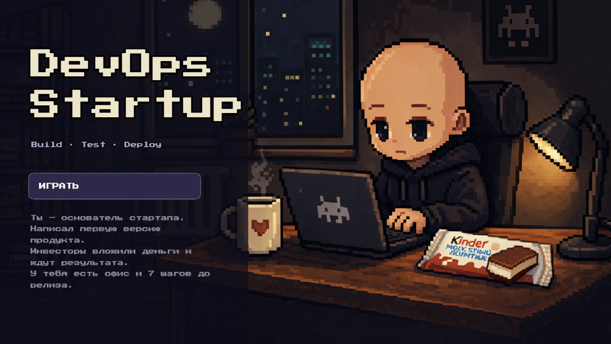
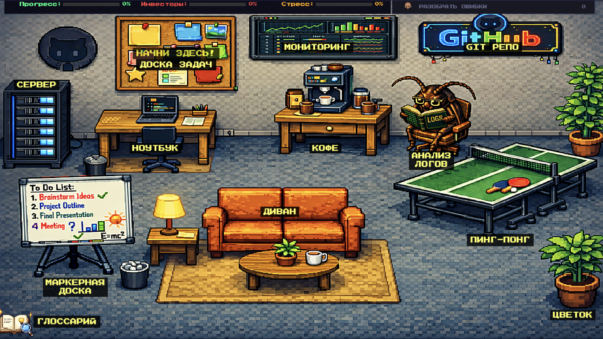
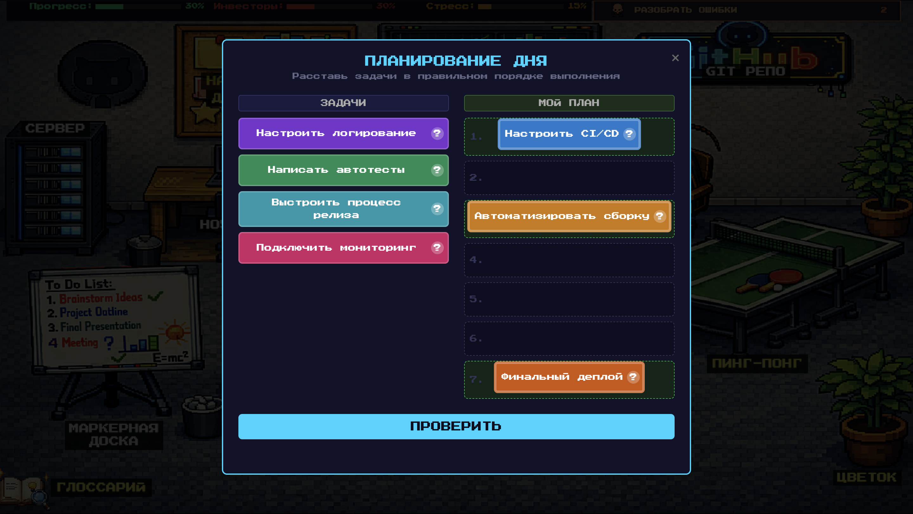

# DevOps Startup

A browser-based educational game about DevOps, built with JavaScript and Phaser for the School 21 hackathon. Players explore a virtual office, complete tasks, and learn core DevOps concepts and practices, including Git, CI/CD, builds and deployments, monitoring, and team workflows.

## Screenshots

**Main menu**



**Office map**



**Task planning**



## What the project includes

- A game scene featuring an office and its characters.
- Tutorials, story-driven tasks, interactive scenarios, and a sandbox mode.
- Interactive learning materials with a glossary and hints.
- Game artwork and separate HTML screen prototypes.
- A Vite development and build setup, plus automated deployment through GitHub Actions.

## Play the game

**Play online:** [DevOps Startup on GitHub Pages](https://devapp-hackathon.github.io/devapp-web-game/)

To run the game locally, open the `game` directory in a terminal and run:

```bash
npm install
npm run dev
```

Then open the address printed by Vite in the terminal (usually `http://localhost:5173`).

## Project structure

- `game/` — game source code, assets, HTML prototypes, and build configuration.
- `project-documents/` — the project concept document and presentation.
